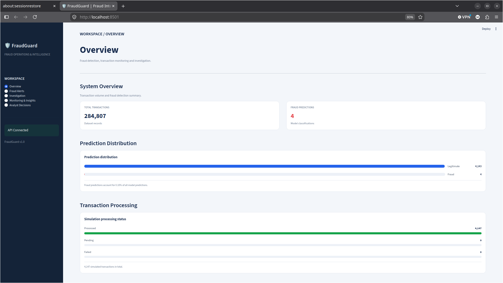
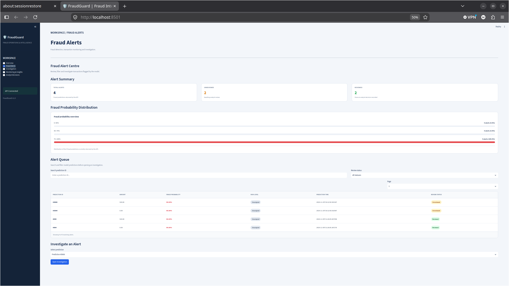
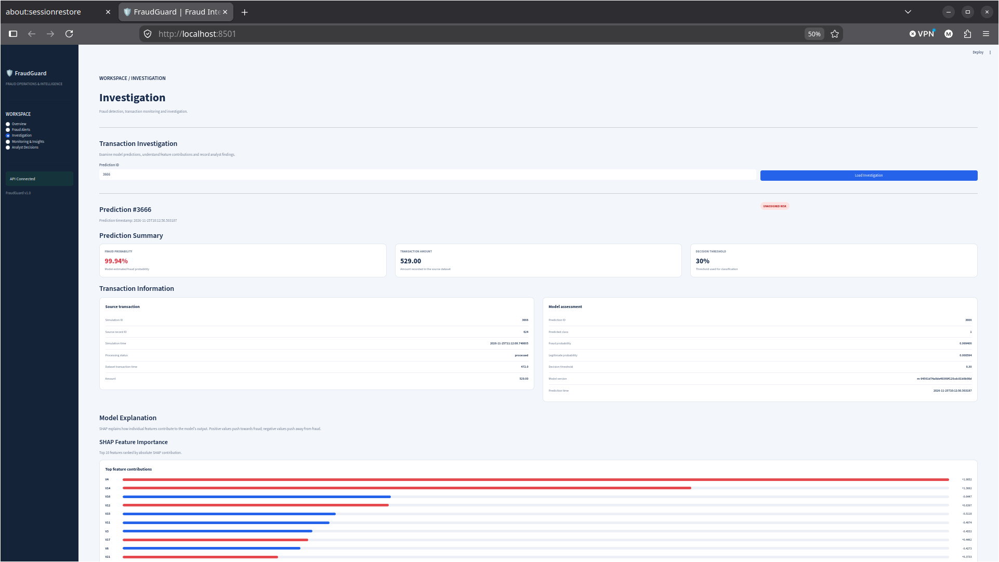
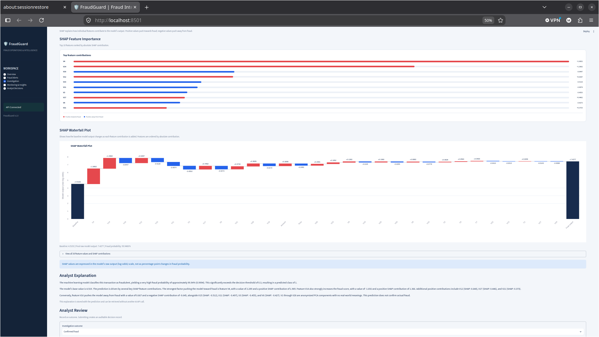
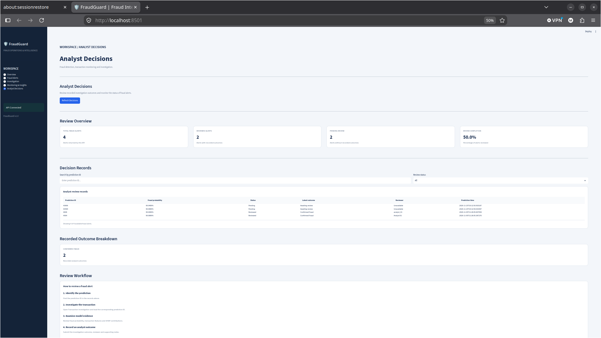
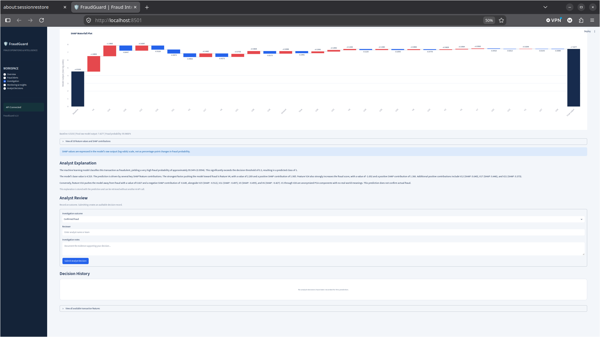

# FraudGuard — Real-Time Fraud Detection and Investigation Platform

An end-to-end machine learning-powered fraud detection platform designed to simulate transaction processing, identify potentially fraudulent transactions, explain model predictions, and support analyst investigations.

---

## 1. Project Overview

FraudGuard is a real-time fraud detection and investigation system built around a machine learning inference pipeline.

The platform combines transaction replay, automated fraud classification, model explainability, database persistence, and AI-assisted analyst explanations into one application.

Rather than stopping at model training and evaluation, FraudGuard demonstrates how a machine learning model can be integrated into a broader application architecture.

The system allows analysts to:
- Monitor transaction processing activities.
- Identify transactions classified as potentially fraudulent.
- Examine fraud probabilities and model predictions.
- Understand model decisions using SHAP explainability.
- Generate natural-language explanations using Google's Gemini API.
- Record investigation outcomes and maintain an auditable decision history.

## 2. Project Objectives

The main objectives are:

- Build an end-to-end fraud detection application around a trained machine learning model.
- Implement dataset-driven transaction replay to simulate incoming transactions.
- Develop an inference engine that processes pending transactions automatically.
- Persist predictions and model explanations in a relational database.
- Integrate SHAP for individual prediction explainability.
- Integrate an LLM to translate model evidence into analyst-friendly explanations.
- Provide an investigation interface for reviewing fraud alerts and recording decisions.

## 3. System Architecture

FraudGuard follows a modular architecture consisting of data storage, transaction simulation, machine learning inference, API services, and an analyst-facing dashboard.

### Architecture overview

```text
                 ORIGINAL DATASET
                        |
                        v
                RAW TRANSACTIONS
                        |
                        v
               TRANSACTION SIMULATOR
                        |
                        v
                 MYSQL DATABASE
                        |
                 PENDING EVENTS
                        |
                        v
                 INFERENCE ENGINE
                        |
              +---------+---------+
              |                   |
              v                   v
         XGBoost Model       SHAP Explainer
              |                   |
              +---------+---------+
                        |
                        v
                PREDICTION RESULTS
                        |
                        v
                  FASTAPI BACKEND
                        |
             +----------+----------+
             |                     |
             v                     v
       STREAMLIT UI          GEMINI API
             |                     |
             v                     v
      ANALYST REVIEW       AI EXPLANATIONS
             |
             v
       MYSQL DATABASE
```

### Main application components

| Component | Responsibility |
|---|---|
| Transaction Simulator | Replays original dataset records and registers simulation events. |
| Inference Engine | Retrieves pending transactions and generates model predictions. |
| XGBoost | Classifies transactions and estimates fraud probabilities. |
| SHAP | Calculates feature contributions for individual predictions. |
| MySQL | Stores raw transactions, simulation events, predictions and analyst decisions. |
| FastAPI | Provides backend services and application endpoints. |
| Streamlit | Provides the analyst dashboard and investigation interface. |
| Gemini API | Generates natural-language explanations from saved SHAP evidence. |
| MLflow | Supports model tracking and model registry workflows. |

## 4. Technology Stack

**Programming Language**
- Python

**Machine Learning**
- XGBoost
- Scikit-learn
- SHAP
- Pandas
- NumPy

**Backend**
- FastAPI
- Uvicorn

**Frontend**
- Streamlit

**Database**
- MySQL

**Model Management**
- MLflow

**LLM Integration**
- Google Gemini API

**Development Tools**
- Git
- GitHub
- VS Code
- Jupyter Notebook

## 5. Dataset

FraudGuard uses the ULB Credit Card Fraud Detection dataset.

The dataset contains transactions made by European cardholders over two days.

Dataset characteristics:

| Attribute | Description |
|---|---|
| Total transactions | 284,807 |
| Total features | 30 input features |
| Target variable | Class |
| Fraud cases | 492 |
| Legitimate cases | 284,315 |
| Class imbalance | Highly imbalanced |

The dataset contains:
- `Time`: Seconds elapsed between transactions and the first transaction.
- `V1`–`V28`: Anonymized PCA-transformed transaction features.
- `Amount`: Transaction amount.
- `Class`: Target variable (0 = legitimate, 1 = fraud).

The `Class` column is used as the ground-truth label during model development. It is not used as an inference feature.

**Important:** The PCA-transformed features do not have directly interpretable real-world meanings. FraudGuard therefore avoids assigning unsupported business interpretations to individual PCA components.

## 6. Machine Learning Model

The platform uses a tuned XGBoost classification model for fraud prediction.

The model receives transaction features and produces a fraud probability.

A decision threshold of `0.30` is currently configured.

```python
if fraud_probability >= 0.30:
    predicted_class = 1
else:
    predicted_class = 0
```

The threshold determines the classification decision and is stored alongside prediction results.

The model is loaded through the MLflow model-management workflow rather than retrained for every inference run.

## 7. Transaction Simulation

FraudGuard implements a dataset-driven transaction replay mechanism.

Instead of generating artificial transaction values, the simulator retrieves original records from the immutable `raw_transactions` table.

The simulator:
1. Retrieves the saved simulation checkpoint.
2. Fetches original transactions using `source_record_id`.
3. Registers each transaction as a simulation event.
4. Assigns a new `simulation_id`.
5. Advances the checkpoint transactionally.
6. Resumes from the saved checkpoint after interruption.
7. Restarts replay when the dataset is exhausted.

This approach preserves the original transaction features while generating the metadata required to simulate transaction processing.

## 8. Machine Learning Inference Pipeline

The inference engine processes transactions registered by the simulator.

Its main responsibilities include:

1. Retrieving pending simulation events.
2. Claiming transactions for processing.
3. Loading the registered machine learning model.
4. Generating fraud probabilities and classifications.
5. Calculating SHAP feature contributions.
6. Persisting prediction results and explainability evidence.
7. Updating transaction processing statuses.
8. Handling failed inference batches.

The inference engine processes transactions in batches and uses the existing database status-management mechanism to prevent already processed transactions from being selected again.

## 9. Model Explainability with SHAP

FraudGuard integrates SHAP (SHapley Additive exPlanations) to explain individual model predictions.

For each supported prediction, the system stores:
- SHAP base value.
- Individual feature contributions.
- Feature values.
- Top contributing features.

The investigation interface displays:

**SHAP Feature Importance**

Ranks the top features by absolute SHAP contribution.

**SHAP Waterfall Plot**

Shows how feature contributions move the model output from its baseline value to the final prediction.

Positive SHAP contributions push the model output towards fraud, while negative contributions push it away from fraud.

SHAP values are expressed in the model's raw output (log-odds) scale, not as percentage-point changes in fraud probability.

## 10. Gemini-Powered Analyst Explanations

FraudGuard integrates Google's Gemini API to convert saved SHAP evidence into natural-language explanations.

The LLM operates as an explanatory layer, not as the fraud classification engine.

The explanation workflow:

1. An analyst opens a fraud investigation.
2. The analyst requests an AI explanation.
3. FastAPI retrieves the saved prediction and SHAP evidence.
4. Relevant evidence is passed to Gemini.
5. Gemini generates a natural-language explanation.
6. The explanation is saved in MySQL.
7. Subsequent requests retrieve the saved explanation without another LLM API call.

The system does not require the LLM to make fraud decisions or independently calculate fraud probabilities.

It also avoids assigning real-world meanings to anonymized PCA features.

## 11. Analyst Investigation and Review

FraudGuard provides an investigation workspace for reviewing model predictions.

Analysts can:
- Examine transaction information.
- Review fraud probabilities and classification thresholds.
- Inspect SHAP feature contributions.
- View SHAP waterfall plots.
- Generate AI-assisted explanations.
- Record investigation outcomes.
- Add investigation notes.
- Maintain a history of analyst decisions.

The application maintains a distinction between a model prediction and an analyst's investigation outcome.

A model prediction identifies a potentially fraudulent transaction; it does not independently establish that fraud occurred.

## 12. Database Architecture

MySQL serves as the central persistence layer.

The main database entities include:

| Table | Purpose |
|---|---|
| `raw_transactions` | Stores original dataset records. |
| `simulated_transactions` | Stores transaction replay events and processing statuses. |
| `prediction_results` | Stores model predictions, probabilities, SHAP evidence and AI explanations. |
| `analyst_decisions` | Stores analyst investigation outcomes and decision history. |
| `simulator_state` | Stores transaction replay checkpoints. |

The database architecture separates original transaction data, simulation metadata, model predictions and analyst decisions.

## 13. Application Screenshots

The following screenshots demonstrate the main features and workflows implemented in FraudGuard.

### 13.1 System Overview Dashboard

The dashboard provides an overview of transaction volume, fraud predictions and transaction processing status.



### 13.2 Fraud Alert Queue

Displays transactions classified as potentially fraudulent for further investigation.



### 13.3 Transaction Investigation

Provides detailed transaction information, model predictions, fraud probabilities and decision thresholds.



### 13.4 SHAP Model Explainability

Visualizes feature contributions to individual fraud predictions using SHAP feature importance and waterfall plots.



### 13.5 Monitoring and Insights

Provides monitoring information and insights into transaction processing and model activity.


### 13.6 Analyst Decisions

Displays recorded investigation outcomes and analyst decision history.



### 13.7 Analyst Review

Allows analysts to record investigation outcomes, reviewer information and supporting notes.



## 14. Project Setup

### Prerequisites

- Python 3.11
- MySQL
- Git
- Access to the configured MLflow tracking and model registry.
- Google Gemini API key.

### Clone the repository

```bash
git clone https://github.com/davidmba819/fraudgaurd.git
cd fraudgaurd
```

### Create a virtual environment

```bash
python3.11 -m venv .venv
```

Activate it:

```bash
source .venv/bin/activate
```

### Install dependencies

```bash
pip install -r requirements.txt
```

### Configure environment variables

Create a local `.env` file using the project's environment configuration template.

Configure the required database credentials, MLflow settings and Gemini API key.

Do not commit `.env` or expose API credentials in the repository.

### Start the FastAPI backend

From the project root:

```bash
PYTHONPATH=. uvicorn backend.main:app --reload --host 0.0.0.0 --port 8007
```

API documentation:

```text
http://localhost:8007/docs
```

### Start the Streamlit application

In a separate terminal:

```bash
streamlit run frontend/app.py
```

### Run the transaction simulator

```bash
PYTHONPATH=. python src/simulator.py
```

### Run the inference engine

```bash
PYTHONPATH=. python src/inference.py
```

The simulator and inference engine currently have separate execution commands. Automated orchestration is part of the planned development work.

**Note:** The database, MLflow tracking service, registered model and required environment variables must be configured before running the application.

## 15. Current Implementation Status

| Feature | Status |
|---|---|
| Dataset preprocessing and model development | Implemented |
| XGBoost model integration | Implemented |
| MLflow model loading | Implemented |
| MySQL database integration | Implemented |
| Transaction replay simulator | Implemented |
| Batch inference engine | Implemented |
| Prediction persistence | Implemented |
| SHAP explainability | Implemented |
| FastAPI backend | Implemented |
| Streamlit dashboard | Implemented |
| Gemini API integration | Implemented |
| AI explanation caching in MySQL | Implemented |
| Analyst decision recording | Implemented |
| Continuous simulator/inference orchestration | Planned |
| Dockerfiles and Docker Compose | Planned |
| Cloud deployment | Planned |

## 16. Future Improvements

The next development milestones include:

- Integrating the simulator and inference engine into a continuously running workflow.
- Implementing reliable service startup, shutdown and recovery.
- Containerizing application components with Docker.
- Creating a Docker Compose configuration for the application services.
- Improving operational logging and system monitoring.
- Deploying the application to a suitable cloud infrastructure.
- Evaluating production-readiness, security and scalability.

## 17. Project Disclaimer

FraudGuard is an engineering and machine learning demonstration built using a publicly available, anonymized credit card transaction dataset.

The transaction replay mechanism simulates transaction arrival and processing. It does not connect to a live banking or payment-processing network.

Model predictions are statistical assessments and should not be treated as definitive evidence of fraudulent activity.

---

## Author

**David Mba**

Machine Learning Engineering | AI Engineering | Data Science

GitHub: [@davidmba819](https://github.com/davidmba819)

Project Repository: [FraudGuard](https://github.com/davidmba819/fraudgaurd)